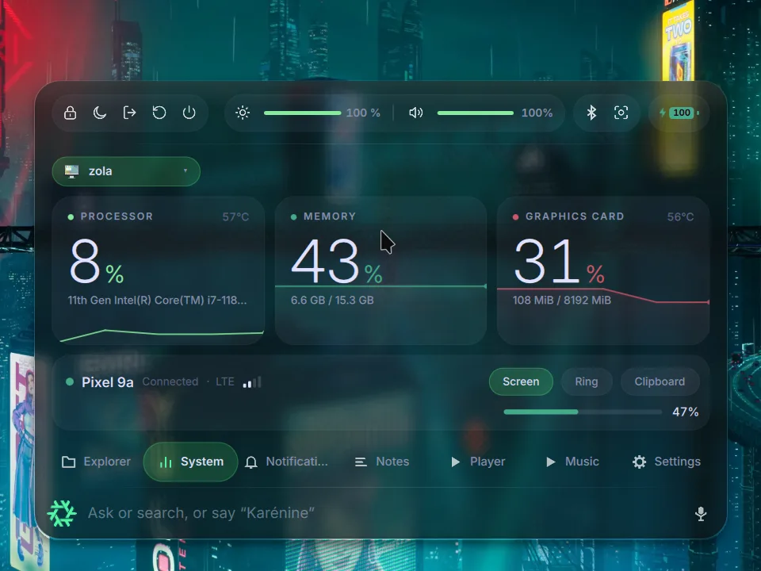
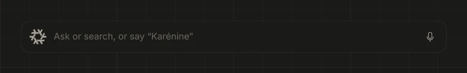
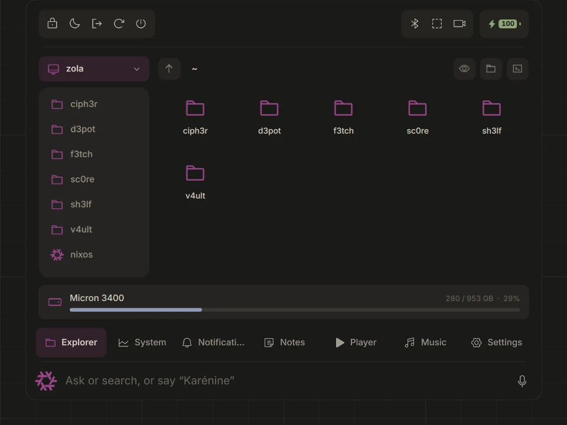
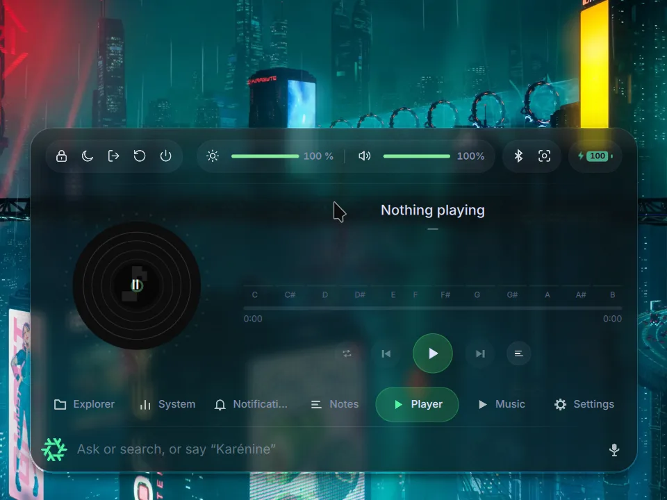
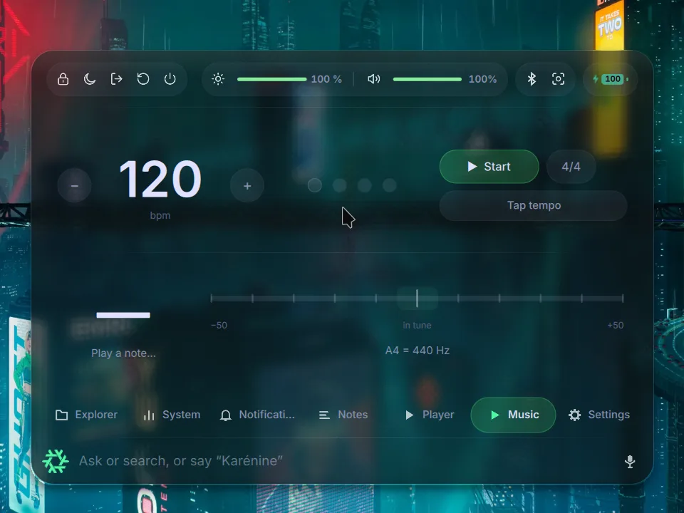
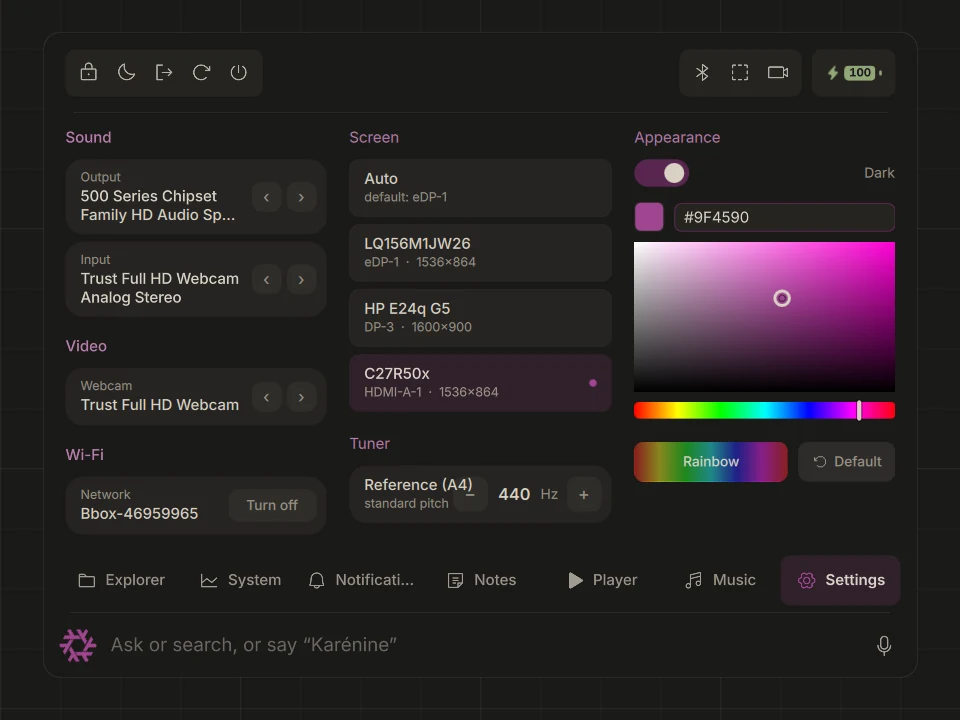

<div align="center">

# karenine

**One bar to talk to your desktop.**

A complete [Quickshell](https://quickshell.org/) desktop for Hyprland: search,
an AI pilot you can speak to, system stats, music tools, your phone, and its
own lock and login screens. QML on the surface, one Rust daemon underneath.



</div>

## Ask, search, or just say “Karénine”



Everything starts from a single bar at the bottom of the screen. Type, and it
searches **applications, files, settings, wallpapers, notes and the web** in
one ranked list. Ask a question, and the **pilot** answers. Say “Karénine”,
and it listens: your voice is transcribed on your own machine by
whisper.cpp, no audio is sent anywhere.

Click the snowflake and the bar grows into a capsule of widgets.

## An AI that actually drives the desktop

The **pilot** is Claude with hands: sound, windows, apps, URLs, projects,
screenshots, accent color, vault notes — the desktop is exposed to it as MCP
tools. “Open YouTube Music in Chrome” just happens. It only acts: code and
research stay with you, in your own Claude Code sessions.

## Everything else, one tab away

<table>
<tr>
<td width="50%"><br><b>System</b> — CPU, memory and GPU with live sparklines and temperatures, and your phone (KDE Connect): screen mirroring, ring, shared clipboard.</td>
<td width="50%"><br><b>Explorer</b> — browse this machine or another one on your Tailscale network (mounted over sshfs), with disk usage at a glance.</td>
</tr>
<tr>
<td><br><b>Player</b> — any MPRIS player, with a live chromagram showing which notes are playing.</td>
<td><br><b>Music</b> — a metronome with tap tempo and a chromatic tuner, running natively in Rust at your device's real sample rate.</td>
</tr>
<tr>
<td><br><b>Settings</b> — audio devices, webcam, Wi-Fi, which screen hosts the bar, and the accent color, applied live everywhere.</td>
<td>

Also in the box:

- 🔔 **Notifications** and 📝 **notes**
- 🔒 **Lock screen and greeter** that share one card (replace hyprlock and regreet)
- ✋ **Webcam gesture control**
- 🔊 Brightness, volume, Bluetooth (music / call profile), battery
- 🌐 **English and French**, and any language you add as one JSON file

</td>
</tr>
</table>

## Why it feels fast

- **One daemon, one socket.** `anna`, written in Rust, does all the work —
  theme, stats, network, audio DSP, gestures, Claude sessions, the pilot,
  voice. The QML only draws, talking JSON lines over a Unix socket.
- **Nothing hard-coded.** Editor, terminal, browser and file manager are
  resolved from `xdg-mime` and `$TERMINAL`; every optional tool only
  disables its own feature when missing.
- **Tested.** Zero qmllint warnings, QML tests, a checked QML ↔ anna contract,
  `cargo clippy -D warnings` and a SonarQube quality gate in CI.

## Install

### With the flake (recommended)

`packages.default` assembles the layout ready for `~/.config/quickshell`. In
the NixOS / Home-Manager configuration that takes this flake as an input:

```nix
home.file.".config/quickshell".source = karenine.packages.${system}.default;
```

### By hand

Copy or symlink the repository into `~/.config/quickshell/` (keeping the
subfolders), build `anna` (`cargo build --release` in `anna/`, needs
`alsa-lib` and `pkg-config`), run it as a daemon, then run `quickshell`.

<details>
<summary><b>Optional system tools</b></summary>

None is required to start the shell; each one only disables its own feature
if it is missing from `$PATH`.

| Tool | Used by | Without it |
| --- | --- | --- |
| `fd` | `services/FileSource.qml` | file search returns nothing |
| `wpctl` (wireplumber) | `widgets/DeviceSettings.qml` | the choice of output, input and webcam is empty |
| `brightnessctl` | `services/Brightness.qml` | the brightness setting does not appear |
| `udevadm` (systemd) | `services/Brightness.qml` | brightness no longer follows changes made elsewhere |
| `upowerd` (UPower) | `services/Battery.qml` | the battery level and its warnings do not appear |
| `nmcli` (NetworkManager) | `widgets/WifiSettings.qml` | the Wi-Fi section does not appear |
| `grimblast` | `services/SettingSource.qml` | the screenshot card does nothing |
| `xdg-mime`, `xdg-open` | `services/DefaultApps.qml`, `FileSource` | roles fall back to the first known tool in `$PATH` |

</details>

<details>
<summary><b>Configuration</b></summary>

- **Bar screen**: `primaryScreen: "DP-1"` in `shell.qml` (substituted by the
  Nix config); the “Screen” setting overrides it and is persisted.
- **Accent color**: `#5277c3` in `services/Theme.qml`, overridden live by
  `anna`.
- **Languages**: interface and voice language are set separately in the
  settings and kept in `~/.config/karenine/locale.json`. The greeter, which
  runs as another user, reads `KARENINE_LANG`.
- **Adding a language**: copy `i18n/en.json`, set `_meta.name`, translate,
  run `tests/i18n-check.sh`. It shows up in the settings by itself.

</details>

## Develop

```sh
nix flake check          # layout, qmllint (zero warnings), QML tests, i18n and QML ↔ anna contract
cd anna && cargo test    # daemon: theme, protocol, DSP, gestures, translations…
nix fmt && cargo fmt     # formatting
```

The full documentation — architecture, panels, widgets, search, AI, backend,
theme — lives in [`docs/content/`](docs/content/index.md).
